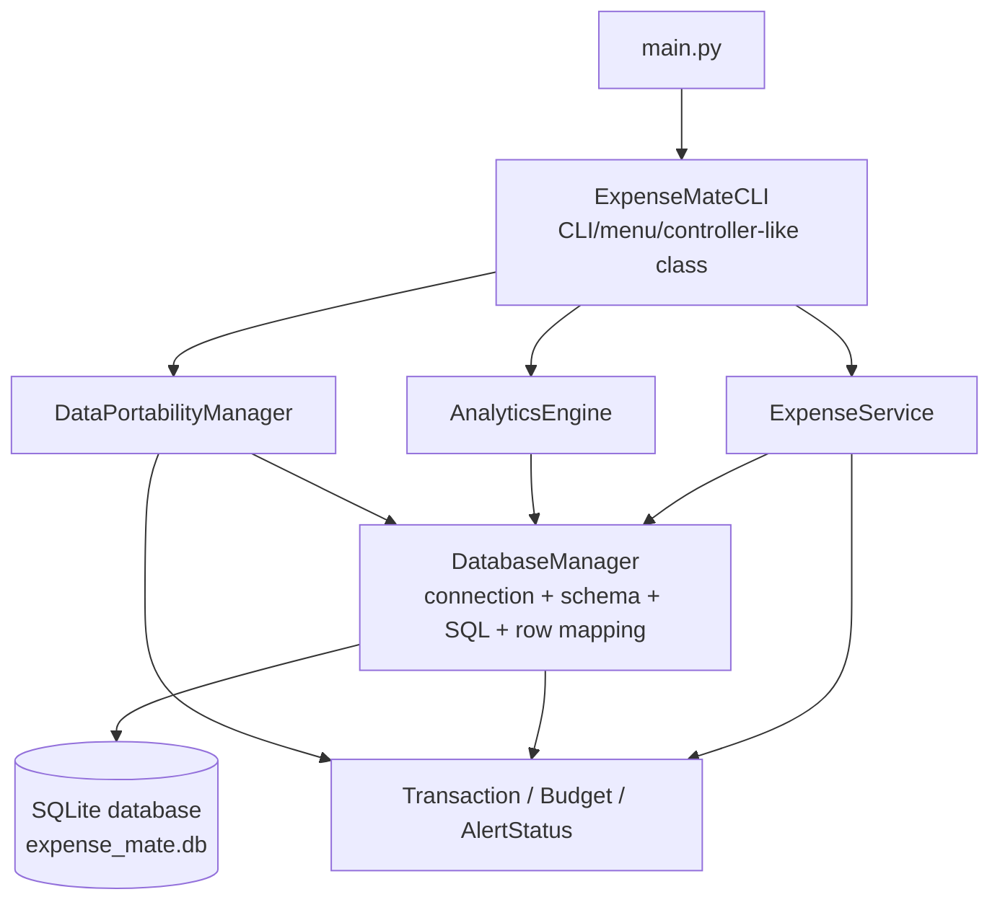

# ExpenseMate Assignment 01
# BEFORE / BASELINE SOFTWARE QUALITY REPORT

**Assignment:** Software Evolution: Migration, Refactoring & Rewriting  
**Project:** ExpenseMate - Personal Expense Manager  
**Baseline:** Existing Assignment 01 source as inspected on 2026-11-05  
**Scope:** Read-only inspection of the files currently present in the project folder

> This is a BEFORE-state report. No source code, database file, test data, or existing
> implementation was modified. The test suite was not executed against the original
> database. All findings below are based on the source files and static counts from
> the inspected project.

---

## 1. Project Overview

### 1.1 Project structure

| Path | Description |
|---|---|
| [`expense_mate/models.py`](C:/Users/afsha/Downloads/files/Source_Code/expense_mate/models.py) | Dataclasses for `Transaction`, `Budget`, and `AlertStatus`, including model validation for transaction and budget values. |
| [`expense_mate/database.py`](C:/Users/afsha/Downloads/files/Source_Code/expense_mate/database.py) | `DatabaseManager`; creates the SQLite schema, opens connections, executes SQL, maps rows to models, and commits writes. |
| [`expense_mate/services.py`](C:/Users/afsha/Downloads/files/Source_Code/expense_mate/services.py) | `ExpenseService`; transaction operations, summaries, budget calculations, currency conversion, and database backup. |
| [`expense_mate/analytics.py`](C:/Users/afsha/Downloads/files/Source_Code/expense_mate/analytics.py) | `AnalyticsEngine`; category breakdowns, monthly trends, and ASCII chart generation. |
| [`expense_mate/importer_exporter.py`](C:/Users/afsha/Downloads/files/Source_Code/expense_mate/importer_exporter.py) | `DataPortabilityManager`; CSV export and import. |
| [`expense_mate/cli.py`](C:/Users/afsha/Downloads/files/Source_Code/expense_mate/cli.py) | `ExpenseMateCLI`; interactive menu, user input, validation, workflow coordination, and console output. |
| [`expense_mate/main.py`](C:/Users/afsha/Downloads/files/Source_Code/expense_mate/main.py) | Application entry point that creates and runs `ExpenseMateCLI`. |
| [`expense_mate/__init__.py`](C:/Users/afsha/Downloads/files/Source_Code/expense_mate/__init__.py) | Package initializer. |
| [`test_expense_mate.py`](C:/Users/afsha/Downloads/files/Source_Code/test_expense_mate.py) | One `unittest` test module containing model, service, database, analytics, and CSV workflow tests. |
| [`project_csv.csv`](C:/Users/afsha/Downloads/files/Source_Code/project_csv.csv) | Sample CSV data with transaction columns and 19 visible sample records. It is not imported automatically by the application. |

No dependency manifest, configuration file, migration directory, documented database
version, or Git metadata was present in the inspected project folder. Therefore, the
exact installation procedure and historical Assignment 01 commit/tag cannot be
verified from this folder.

### 1.2 Technology

- **Language:** Python.
- **Database:** SQLite through the Python standard-library `sqlite3` module
  ([`database.py:1`](C:/Users/afsha/Downloads/files/Source_Code/expense_mate/database.py:1)).
- **Standard-library modules used:** `sqlite3`, `contextlib`, `typing`, `dataclasses`,
  `datetime`, `os`, `shutil`, `csv`, `unittest`, and `tempfile`.
- **External libraries:** None are imported by the inspected Python files. This is a
  source-level observation; no dependency manifest was available.
- **Interface:** Interactive command-line interface, started by
  [`main.py:1-6`](C:/Users/afsha/Downloads/files/Source_Code/expense_mate/main.py:1).
- **Testing framework:** `unittest` in [`test_expense_mate.py`](C:/Users/afsha/Downloads/files/Source_Code/test_expense_mate.py).

### 1.3 Implemented features

The menu in [`cli.py:86-105`](C:/Users/afsha/Downloads/files/Source_Code/expense_mate/cli.py:86)
exposes these features:

1. Add income or expense transactions.
2. View all transactions.
3. View total income, total expense, and net balance.
4. Create monthly budgets and view budget alerts.
5. View category expense breakdown with an ASCII bar chart.
6. View monthly income, expense, and savings trends.
7. Export transactions to CSV.
8. Import transactions from CSV.
9. Convert between supported currencies.
10. Back up the SQLite database.

### 1.4 High-level communication

`main.py` creates `ExpenseMateCLI`. The CLI constructs one `DatabaseManager`, then
passes the same database object to `ExpenseService`, `AnalyticsEngine`, and
`DataPortabilityManager` ([`cli.py:9-14`](C:/Users/afsha/Downloads/files/Source_Code/expense_mate/cli.py:9)).
The CLI calls those objects directly according to the selected menu option.

---

## 2. Current Architecture

### 2.1 Is this a layered architecture?

The project has recognizable model, service, database, analytics, import/export, and
CLI modules, but it does **not** currently implement the required
`Controller -> Services -> Repository -> Database` architecture.

The main reason is that there is no repository layer. `DatabaseManager` is both the
connection manager and the data-access implementation. `ExpenseService`,
`AnalyticsEngine`, and `DataPortabilityManager` depend directly on it. The CLI is a
menu/controller-like object, but it also contains substantial input validation,
workflow logic, formatting, and error handling.

### 2.2 Responsibility locations

| Responsibility | Current location and evidence |
|---|---|
| User input | `ExpenseMateCLI.run()` reads menu choices and transaction, budget, import, and currency values using `input()` ([`cli.py:86-452`](C:/Users/afsha/Downloads/files/Source_Code/expense_mate/cli.py:86)). |
| Basic input validation | Some validation is in CLI methods (`validate_transaction_data`, `validate_currency_data`) and some is repeated inline in `run()` ([`cli.py:24-84`](C:/Users/afsha/Downloads/files/Source_Code/expense_mate/cli.py:24)). |
| Domain/model validation | `Transaction.validate()` and `Budget.validate()` validate values and date formats ([`models.py:15-44`](C:/Users/afsha/Downloads/files/Source_Code/expense_mate/models.py:15)). |
| Business calculations | `ExpenseService` calculates summaries, budget spending, alert levels, currency conversion, and backup paths ([`services.py:38-131`](C:/Users/afsha/Downloads/files/Source_Code/expense_mate/services.py:38)). `AnalyticsEngine` calculates category totals, trends, percentages, and chart bar lengths ([`analytics.py:10-95`](C:/Users/afsha/Downloads/files/Source_Code/expense_mate/analytics.py:10)). |
| SQL execution | All inspected SQL is in `DatabaseManager` ([`database.py:23-141`](C:/Users/afsha/Downloads/files/Source_Code/expense_mate/database.py:23)). No SQL was found in the service, analytics, CLI, or importer/exporter files. |
| Database connection management | `get_connection()` opens a new SQLite connection, sets `sqlite3.Row`, yields it, and closes it in `finally` ([`database.py:14-21`](C:/Users/afsha/Downloads/files/Source_Code/expense_mate/database.py:14)). |
| Transaction/budget persistence | `DatabaseManager` validates models, executes writes, commits, and maps rows to dataclasses ([`database.py:52-141`](C:/Users/afsha/Downloads/files/Source_Code/expense_mate/database.py:52)). |
| Console presentation | CLI prints menus, tables, summaries, alerts, charts, and errors throughout `run()` ([`cli.py:86-452`](C:/Users/afsha/Downloads/files/Source_Code/expense_mate/cli.py:86)). |

### 2.3 BEFORE architecture diagram



The diagram shows the direct dependency from three application components to
`DatabaseManager`. A dedicated repository abstraction is absent.

### 2.4 Separation assessment

There is partial separation by module, but responsibilities are not fully separated:

- The database class combines schema initialization, connection lifecycle, SQL, model
  validation invocation, transaction commits, and row-to-model mapping.
- `ExpenseService` combines transaction management, reporting calculations, budget
  calculations, currency conversion, and filesystem backup.
- `AnalyticsEngine` directly queries the database and also formats presentation output
  as ASCII.
- `ExpenseMateCLI` combines controller behavior, repeated validation, business
  workflow coordination, presentation, and broad exception handling.

This structure is workable for a small CLI, but it makes isolated testing and future
replacement of SQLite more difficult.

---

## 3. Migration Analysis

### 3.1 Current database implementation

`DatabaseManager.__init__()` stores a path and immediately calls `_init_schema()`
([`database.py:8-12`](C:/Users/afsha/Downloads/files/Source_Code/expense_mate/database.py:8)).
The default path is the relative file `expense_mate.db`; the CLI also defaults to that
path ([`cli.py:10`](C:/Users/afsha/Downloads/files/Source_Code/expense_mate/cli.py:10)).

Each operation obtains a fresh connection through the context manager:

1. `sqlite3.connect(self.db_path)` opens the database.
2. `row_factory` is set to `sqlite3.Row`.
3. The caller uses the connection.
4. The connection is closed in `finally`.

Writes call `conn.commit()` in `insert_transaction()` and `upsert_budget()`.
Database errors are translated to `RuntimeError` during schema/read operations and
to `ValueError` for write operations ([`database.py:48-64`](C:/Users/afsha/Downloads/files/Source_Code/expense_mate/database.py:48)).

### 3.2 SQL operations and locations

The static scan found **9 `cursor.execute` calls containing SQL**, all in
[`database.py`](C:/Users/afsha/Downloads/files/Source_Code/expense_mate/database.py):

| Location | SQL operation |
|---|---|
| [`database.py:27-35`](C:/Users/afsha/Downloads/files/Source_Code/expense_mate/database.py:27) | Create `transactions` table if absent |
| [`database.py:37-44`](C:/Users/afsha/Downloads/files/Source_Code/expense_mate/database.py:37) | Create `budgets` table if absent |
| [`database.py:46`](C:/Users/afsha/Downloads/files/Source_Code/expense_mate/database.py:46) | Create transaction date index |
| [`database.py:47`](C:/Users/afsha/Downloads/files/Source_Code/expense_mate/database.py:47) | Create transaction category index |
| [`database.py:57-60`](C:/Users/afsha/Downloads/files/Source_Code/expense_mate/database.py:57) | Insert transaction |
| [`database.py:70`](C:/Users/afsha/Downloads/files/Source_Code/expense_mate/database.py:70) | Select all transactions ordered by date and ID |
| [`database.py:90-95`](C:/Users/afsha/Downloads/files/Source_Code/expense_mate/database.py:90) | Insert or update budget using `ON CONFLICT` |
| [`database.py:105-107`](C:/Users/afsha/Downloads/files/Source_Code/expense_mate/database.py:105) | Select one budget by category and month |
| [`database.py:127-129`](C:/Users/afsha/Downloads/files/Source_Code/expense_mate/database.py:127) | Select budgets for a month |

No direct SQL was found inside `services.py`, `analytics.py`, `cli.py`, or
`importer_exporter.py`. However, these classes directly depend on
`DatabaseManager`, so the data-access boundary is still concrete rather than
repository-based.

### 3.3 Existing schema

The schema is created imperatively at application startup:

**`transactions` table** ([`database.py:27-35`](C:/Users/afsha/Downloads/files/Source_Code/expense_mate/database.py:27)):

- `id INTEGER PRIMARY KEY AUTOINCREMENT`
- `amount REAL NOT NULL`
- `category TEXT NOT NULL`
- `trans_type TEXT NOT NULL`
- `date TEXT NOT NULL`
- `description TEXT DEFAULT ''`

**`budgets` table** ([`database.py:37-44`](C:/Users/afsha/Downloads/files/Source_Code/expense_mate/database.py:37)):

- `id INTEGER PRIMARY KEY AUTOINCREMENT`
- `category TEXT NOT NULL`
- `monthly_limit REAL NOT NULL`
- `month_year TEXT NOT NULL`
- `UNIQUE(category, month_year)`

**Indexes:**

- `idx_trans_date` on `transactions(date)`
- `idx_trans_cat` on `transactions(category)`

There is no version table, numbered migration script, explicit schema version, or
rollback procedure in the inspected project.

### 3.4 Current configuration management

The database path is a constructor/default argument, not an external configuration
value. The CLI and `DatabaseManager` use the hard-coded default
`expense_mate.db` ([`database.py:9`](C:/Users/afsha/Downloads/files/Source_Code/expense_mate/database.py:9);
[`cli.py:10`](C:/Users/afsha/Downloads/files/Source_Code/expense_mate/cli.py:10).

Currency exchange rates are hard-coded in `ExpenseService.EXCHANGE_RATES`
([`services.py:11-18`](C:/Users/afsha/Downloads/files/Source_Code/expense_mate/services.py:11)).
Backup directory and CSV export filename are also defaults in source/CLI
([`services.py:113`](C:/Users/afsha/Downloads/files/Source_Code/expense_mate/services.py:113);
[`cli.py:361-366`](C:/Users/afsha/Downloads/files/Source_Code/expense_mate/cli.py:361)).
No environment-variable, configuration-file, or secret-management mechanism was found.

### 3.5 Migration opportunities for Assignment 02

The most direct migration opportunity is to introduce a repository/data-access layer:

- Preserve the existing SQLite schema and records.
- Move transaction and budget SQL behind repository classes.
- Make services depend on repository interfaces/objects rather than the concrete
  database manager.
- Add repeatable verification using a copy or temporary database.

Other possible migrations are configuration externalization or a versioned schema
migration system. These are opportunities only; no migration was performed in this
baseline task.

---

## 4. Refactoring Analysis

### Feature 1: Add Transaction and Transaction Listing

#### Current implementation

The add-transaction workflow is implemented in the `choice == "1"` branch of
`ExpenseMateCLI.run()` ([`cli.py:108-181`](C:/Users/afsha/Downloads/files/Source_Code/expense_mate/cli.py:108)).
The CLI:

1. Reads transaction type, amount, category, date, and description.
2. Validates values inline with loops and `datetime.strptime`.
3. Calls `ExpenseService.add_transaction()`.
4. Checks the budget after an expense and prints an alert.

`ExpenseService.add_transaction()` constructs a `Transaction` and delegates to
`DatabaseManager.insert_transaction()` ([`services.py:23-25`](C:/Users/afsha/Downloads/files/Source_Code/expense_mate/services.py:23)).
The database manager validates the model, strips selected strings, executes SQL, and
commits ([`database.py:52-64`](C:/Users/afsha/Downloads/files/Source_Code/expense_mate/database.py:52)).

Listing uses `ExpenseService.list_transactions()`, which retrieves all records and
then filters them in Python ([`services.py:27-36`](C:/Users/afsha/Downloads/files/Source_Code/expense_mate/services.py:27)).

#### Dependency flow

```text
CLI input/validation
  -> ExpenseService.add_transaction/list_transactions
  -> DatabaseManager.insert_transaction/get_all_transactions
  -> SQLite
```

#### Design problems

- The CLI owns extensive validation and workflow logic rather than delegating a
  stable application service/controller contract.
- `ExpenseService` is coupled directly to `DatabaseManager`.
- Listing always loads all transactions before filtering, even though filtering is
  a data-access concern that could be implemented by a repository query.
- `DatabaseManager.insert_transaction()` invokes model validation and also performs
  persistence, which mixes domain validation and data access.
- The method `validate_transaction_data()` exists in the CLI
  ([`cli.py:34-62`](C:/Users/afsha/Downloads/files/Source_Code/expense_mate/cli.py:34)),
  but the add workflow repeats equivalent validation inline instead of using it.

### Feature 2: Monthly Budget Summary and Alerts

#### Current implementation

The budget workflow is in the `choice == "4"` branch of the CLI
([`cli.py:220-313`](C:/Users/afsha/Downloads/files/Source_Code/expense_mate/cli.py:220)).
The CLI validates the month, displays existing statuses, optionally gathers a budget,
calls `set_budget()`, and then reloads statuses.

`ExpenseService.check_budget_status()` retrieves one budget from the database, retrieves
all transactions, filters them in Python by category, type, and month, calculates the
percentage, selects `NORMAL`, `WARNING`, or `CRITICAL`, and creates an `AlertStatus`
([`services.py:55-87`](C:/Users/afsha/Downloads/files/Source_Code/expense_mate/services.py:55)).

`get_all_budget_statuses()` gets all budgets for the month and calls
`check_budget_status()` once per budget ([`services.py:89-98`](C:/Users/afsha/Downloads/files/Source_Code/expense_mate/services.py:89)).

#### Dependency flow

```text
CLI month/budget input
  -> ExpenseService.set_budget/get_all_budget_statuses/check_budget_status
  -> DatabaseManager.upsert_budget/get_budgets_for_month/get_budget/get_all_transactions
  -> SQLite
```

#### Design problems

- The service repeatedly loads all transactions and performs filtering/calculation in
  memory. The repository/database layer has no monthly expense query.
- The budget status calculation depends on both budget persistence and transaction
  persistence through the same concrete database object.
- For multiple budgets, `get_all_budget_statuses()` calls `check_budget_status()` for
  each budget; each call retrieves all transactions again. This is a likely
  performance and responsibility problem, although runtime performance was not
  benchmarked.
- The CLI contains budget input loops, date parsing, persistence calls, and output
  formatting in one large `run()` method.

### Additional refactoring target: Analytics

`AnalyticsEngine` directly calls `DatabaseManager.get_all_transactions()` for both
category breakdown and monthly trends ([`analytics.py:10-56`](C:/Users/afsha/Downloads/files/Source_Code/expense_mate/analytics.py:10)).
It also formats an ASCII chart in the same class ([`analytics.py:58-95`](C:/Users/afsha/Downloads/files/Source_Code/expense_mate/analytics.py:58)).
This makes the class responsible for data retrieval, filtering, aggregation, and
presentation formatting.

---

## 5. Class Rewriting Analysis

### 5.1 Major classes inspected

The production code contains these eight classes:

1. `Transaction`
2. `Budget`
3. `AlertStatus`
4. `DatabaseManager`
5. `ExpenseService`
6. `AnalyticsEngine`
7. `DataPortabilityManager`
8. `ExpenseMateCLI`

The test module contains one additional test class, `TestExpenseMate`.

### 5.2 Recommended complete rewrite: `ExpenseService`

**Location:** [`services.py:10-131`](C:/Users/afsha/Downloads/files/Source_Code/expense_mate/services.py:10)

#### Existing responsibilities

- Create and save transactions.
- Retrieve and filter transactions.
- Calculate income, expense, and savings summaries.
- Create/update budgets.
- Calculate spending and budget alert levels.
- Convert currencies using hard-coded rates.
- Copy the SQLite database to a backup path.

#### Methods and dependencies

`ExpenseService` has nine methods after construction:
`add_transaction`, `list_transactions`, `get_net_summary`, `set_budget`,
`check_budget_status`, `get_all_budget_statuses`, `convert_amount`, and
`create_database_backup` plus its constructor. It directly depends on
`DatabaseManager`, `Transaction`, `Budget`, and `AlertStatus`; it also depends on
filesystem modules `os` and `shutil` ([`services.py:1-7`](C:/Users/afsha/Downloads/files/Source_Code/expense_mate/services.py:1)).

#### Specific problems

- Low cohesion: persistence coordination, financial calculations, currency conversion,
  and filesystem backup are unrelated concerns.
- High coupling: a single class depends on the database implementation and filesystem.
- Difficult isolated testing: testing a currency conversion or budget rule requires
  constructing a service with a database manager, even when persistence is not needed.
- The budget calculation retrieves all transactions and performs filtering in the
  service instead of using a focused data-access operation.
- Currency rates are embedded as a class constant, making change and configuration
  difficult.

#### Why a complete rewrite is justified

A minor rename or method rearrangement would leave the class with the same mixed
responsibilities and concrete dependencies. A rewrite can define focused application
services and explicit repository dependencies while preserving public workflows.

#### Expected improved design

Possible target design:

```text
TransactionService -> TransactionRepository
BudgetService      -> BudgetRepository + TransactionRepository
AnalyticsService   -> TransactionRepository
CurrencyService    -> CurrencyRateProvider/configuration
BackupService      -> Backup/file-system abstraction
```

The exact class names should be selected during Assignment 02 design, but each class
should have one primary reason to change and should be independently testable.

### 5.3 Recommended complete rewrite: `AnalyticsEngine`

**Location:** [`analytics.py:6-95`](C:/Users/afsha/Downloads/files/Source_Code/expense_mate/analytics.py:6)

#### Existing responsibilities

- Retrieve all transactions from the database.
- Filter by transaction type and month.
- Aggregate category totals.
- Aggregate monthly income, expenses, and savings.
- Sort trend results.
- Calculate chart percentages and bar lengths.
- Format an ASCII chart string.

#### Methods and dependencies

The class has a constructor and three public methods:
`get_category_breakdown`, `get_monthly_trends`, and `generate_ascii_bar_chart`.
It depends directly on `DatabaseManager` and `Transaction` data returned by it.

#### Specific problems

- Data access and analytics are coupled.
- Business aggregation and presentation formatting are coupled.
- The chart method uses a Unicode block character (`█`), which is a presentation
  concern and can be separated from calculations.
- The class cannot easily be tested with a small in-memory list unless the database
  dependency is replaced or mocked.

#### Why a complete rewrite is justified

The class has two distinct responsibilities: producing analytical values and
rendering those values. Rewriting it around a repository/service boundary is clearer
than adding more conditional logic to the existing database-coupled class.

#### Expected improved design

```text
AnalyticsService(repository) -> breakdown/trend data
ChartFormatter               -> ASCII presentation
```

The service should accept repository results or a repository abstraction, while the
formatter should accept dictionaries of calculated values and return display text.

### 5.4 Other classes and rewrite priority

| Class | Assessment |
|---|---|
| `ExpenseMateCLI` | Large orchestration method (`run()` spans [`cli.py:86-452`](C:/Users/afsha/Downloads/files/Source_Code/expense_mate/cli.py:86)) containing menu control, input, validation, workflows, formatting, and exception handling. It is a strong refactoring target; a controller rewrite may be appropriate after service boundaries are defined. |
| `DatabaseManager` | Combines connection management, schema creation, SQL, commits, validation invocation, and row mapping. It should be split or rewritten into a database connection/schema component plus repositories for Assignment 02. |
| `DataPortabilityManager` | Focused on CSV but directly depends on the database and contains broad per-row exception handling in [`importer_exporter.py:51-99`](C:/Users/afsha/Downloads/files/Source_Code/expense_mate/importer_exporter.py:51). It is a secondary rewrite/refactor candidate. |
| `Transaction` and `Budget` | Small dataclasses with focused validation. They are not the highest-priority rewrite targets based on the inspected code. |
| `AlertStatus` | Data-only dataclass with no methods; no evidence of excessive responsibility. |

---

## 6. Existing Testing Analysis

### 6.1 Test inventory

- **Test files:** 1 (`test_expense_mate.py`).
- **Test class:** 1 (`TestExpenseMate`).
- **Test methods:** 9 methods whose names begin with `test_`.
- **Setup/teardown methods:** `setUp()` and `tearDown()`.

These counts are from the declarations in
[`test_expense_mate.py:14-112`](C:/Users/afsha/Downloads/files/Source_Code/test_expense_mate.py:14).

### 6.2 Tested functionality

| Test | Functionality |
|---|---|
| `test_transaction_validation_valid` | Valid transaction model validation |
| `test_transaction_validation_negative_amount` | Reject negative transaction amount |
| `test_transaction_validation_invalid_date` | Reject invalid transaction date |
| `test_insert_and_get_all_transactions` | Save two transactions and retrieve them |
| `test_net_summary_calculation` | Monthly income, expense, and savings calculation |
| `test_budget_threshold_alerts` | Normal, warning, and critical budget thresholds |
| `test_currency_conversion` | USD/PKR conversion in both directions |
| `test_csv_export_and_import` | Export to CSV and import into a second temporary database |
| `test_analytics_breakdown` | Category aggregation for expenses and month |

### 6.3 Test classification

The file does not label tests as unit or integration tests. Based on their behavior:

- **Unit-like tests:** model validation and currency conversion.
- **Integration/workflow-like tests:** database persistence, service summary, budget
  status, analytics against SQLite, and CSV export/import.

All tests create a temporary database with `tempfile.mkstemp()` in `setUp()` and
delete it in `tearDown()` ([`test_expense_mate.py:15-25`](C:/Users/afsha/Downloads/files/Source_Code/test_expense_mate.py:15)).
The CSV test creates a second temporary database. This suggests the suite is designed
not to use the default original database, but the suite was not executed for this
baseline report.

### 6.4 Missing test coverage

The inspected suite does not explicitly test:

- Database schema creation and index existence.
- Duplicate budget upsert behavior for the same category/month.
- Empty database behavior for all summaries and analytics.
- Transaction listing filters by type and category.
- Budget status when no budget exists.
- All supported currencies and invalid currency codes.
- Backup creation and backup contents.
- CSV malformed headers, missing fields, invalid rows, or partial-import behavior.
- CLI input flows, invalid menu choices, keyboard interruption, or console output.
- Repository boundaries, because no repository layer exists.
- Database error paths and rollback behavior.
- Regression comparison against an Assignment 01 baseline branch/tag.

### 6.5 Regression testing assessment

There is no separate regression test suite, baseline tag, test report, or recorded
before/after test result in the inspected folder. The existing tests cover several
Assignment 01 behaviors, but they are not identified as regression tests and cannot
by themselves prove that all original features remain functional after future changes.

---

## 7. Maintainability Baseline Metrics

### 7.1 Measurement method

The counts below were obtained by recursively enumerating `.py` files and counting
source lines from the current project folder. Class and function counts were obtained
from the `class` and `def` declarations in the inspected files. SQL counts were
obtained by locating `cursor.execute` calls and SQL statements. These are static
baseline measurements, not runtime measurements.

### 7.2 Measured metrics

| Metric | Baseline result | Measurement notes |
|---|---:|---|
| Python files | **9** | Includes 8 project files under `expense_mate/` and 1 test file. |
| Production Python files | **8** | `__init__.py`, analytics, CLI, database, importer/exporter, main, models, services. |
| Test files | **1** | `test_expense_mate.py`. |
| Total Python lines | **1,103** | Physical lines, including blank lines, in all 9 Python files. |
| Non-blank Python lines | **880** | Physical lines excluding lines matching whitespace-only. |
| Blank Python lines | **223** | Physical whitespace-only lines. |
| Largest source file | **452 lines** | [`cli.py`](C:/Users/afsha/Downloads/files/Source_Code/expense_mate/cli.py). |
| Production classes | **8** | Three model classes plus five application classes. |
| Test classes | **1** | `TestExpenseMate`. |
| Function/method definitions | **44** | 33 production methods/functions and 11 test methods/setup methods; class declarations excluded. |
| All class/function declarations | **53** | 9 class declarations plus 44 function/method declarations. |
| SQL execution sites | **9** | All in [`database.py`](C:/Users/afsha/Downloads/files/Source_Code/expense_mate/database.py), lines listed in Section 3.2. |
| Database tables | **2** | `transactions` and `budgets`. |
| Database indexes | **2** | Date and category indexes on `transactions`. |
| Explicit external configuration files | **0 found** | No `.env`, JSON, YAML, TOML, INI, or dependency manifest was present in the inspected folder. |

The per-file line counts were:

| File | Lines | Non-blank |
|---|---:|---:|
| [`test_expense_mate.py`](C:/Users/afsha/Downloads/files/Source_Code/test_expense_mate.py) | 122 | 98 |
| [`analytics.py`](C:/Users/afsha/Downloads/files/Source_Code/expense_mate/analytics.py) | 95 | 70 |
| [`cli.py`](C:/Users/afsha/Downloads/files/Source_Code/expense_mate/cli.py) | 452 | 348 |
| [`database.py`](C:/Users/afsha/Downloads/files/Source_Code/expense_mate/database.py) | 142 | 128 |
| [`importer_exporter.py`](C:/Users/afsha/Downloads/files/Source_Code/expense_mate/importer_exporter.py) | 99 | 79 |
| [`main.py`](C:/Users/afsha/Downloads/files/Source_Code/expense_mate/main.py) | 6 | 4 |
| [`models.py`](C:/Users/afsha/Downloads/files/Source_Code/expense_mate/models.py) | 53 | 45 |
| [`services.py`](C:/Users/afsha/Downloads/files/Source_Code/expense_mate/services.py) | 131 | 105 |
| [`__init__.py`](C:/Users/afsha/Downloads/files/Source_Code/expense_mate/__init__.py) | 3 | 3 |

### 7.3 Multiple-responsibility classes

The following responsibility counts are qualitative classifications based on actual
methods:

- `ExpenseService`: at least five responsibility areas (transactions, summaries,
  budgets, currency, backup).
- `DatabaseManager`: at least four responsibility areas (connections, schema,
  persistence SQL, row/model mapping).
- `AnalyticsEngine`: at least four responsibility areas (retrieval, filtering,
  aggregation, rendering).
- `ExpenseMateCLI`: at least five responsibility areas (menu, input, validation,
  workflow coordination, presentation/error handling).
- `DataPortabilityManager`: CSV serialization/deserialization plus database
  persistence coordination.

These are responsibility categories, not a standardized automated metric.

### 7.4 Duplication

Duplicated or overlapping logic is visible in the source:

- Transaction type, positive amount, non-empty category, and date checks are
  implemented in both `validate_transaction_data()` and the inline add workflow
  ([`cli.py:34-62`](C:/Users/afsha/Downloads/files/Source_Code/expense_mate/cli.py:34);
  [`cli.py:108-181`](C:/Users/afsha/Downloads/files/Source_Code/expense_mate/cli.py:108)).
- Month validation is repeated in budget and analytics menu branches
  ([`cli.py:225-246`](C:/Users/afsha/Downloads/files/Source_Code/expense_mate/cli.py:225);
  [`cli.py:316-340`](C:/Users/afsha/Downloads/files/Source_Code/expense_mate/cli.py:316)).
- Similar `try/except Exception` and `show_error()` patterns are repeated for
  individual menu choices throughout `run()`.

An exact duplicated-line count was **not measured**, because no token-based clone
detector was used and manually counting overlapping validation logic would not be a
reproducible clone metric.

### 7.5 Cyclomatic complexity

Cyclomatic complexity was **not measured with an automated analyzer** in this
baseline. The source visibly contains a large branch/loop method:
`ExpenseMateCLI.run()` includes a `while` loop and a long `if/elif` menu chain
([`cli.py:86-452`](C:/Users/afsha/Downloads/files/Source_Code/expense_mate/cli.py:86)).
That is evidence of a complexity and maintainability risk, but an exact complexity
number must be obtained later using a named, repeatable analyzer and its version.

### 7.6 Existing test coverage

Coverage was **not measured**. The test suite was not executed for this baseline
report, and no existing coverage artifact was present. Therefore, no percentage is
claimed.

---

## 8. Recommended Assignment 02 Changes

### A. Migration

| Item | Recommendation |
|---|---|
| Current problem | SQL and persistence behavior are concentrated in a concrete `DatabaseManager`; there is no versioned migration procedure or repository abstraction. |
| Proposed change | Introduce `TransactionRepository` and `BudgetRepository`, preserving SQLite and existing records. Optionally add a numbered schema/configuration migration with a repeatable verification procedure. |
| Files/classes affected | [`database.py`](C:/Users/afsha/Downloads/files/Source_Code/expense_mate/database.py), new repository module(s), migration script/procedure, service constructors, and database tests. |
| Expected improvement | Data-access implementation becomes replaceable and testable; services no longer need to know SQL/connection details; existing records can be verified after migration. |
| Later verification | Run the procedure against a copied/temporary database, compare record counts and values before/after, and run repository/service tests. Do not overwrite the baseline database during verification. |

### B. Refactoring into required layered architecture

| Item | Recommendation |
|---|---|
| Current problem | The required repository layer is missing. CLI, services, analytics, and portability components depend directly on `DatabaseManager`. |
| Proposed change | Establish `Controller -> Services -> Repository -> Database`. Keep CLI input/output in controller code, move application rules to focused services, and keep SQL in repositories/database components. |
| Files/classes affected | [`cli.py`](C:/Users/afsha/Downloads/files/Source_Code/expense_mate/cli.py), [`services.py`](C:/Users/afsha/Downloads/files/Source_Code/expense_mate/services.py), [`analytics.py`](C:/Users/afsha/Downloads/files/Source_Code/expense_mate/analytics.py), [`importer_exporter.py`](C:/Users/afsha/Downloads/files/Source_Code/expense_mate/importer_exporter.py), [`database.py`](C:/Users/afsha/Downloads/files/Source_Code/expense_mate/database.py), and new repository/service modules. |
| Expected improvement | Clear dependency direction, reduced coupling, focused responsibilities, and easier unit testing with repository doubles/mocks. |
| Later verification | Trace Add Transaction and Monthly Budget Summary through all four layers; inspect imports/dependencies to ensure controllers/services do not execute SQL; run integration tests. |

### C. Rewriting selected classes

| Item | Recommendation |
|---|---|
| Current problem | `ExpenseService` combines unrelated financial, persistence, currency, and filesystem concerns. |
| Proposed change | Rewrite into focused transaction, budget, currency, analytics, and backup services as appropriate, with repository dependencies injected. |
| Files/classes affected | [`services.py`](C:/Users/afsha/Downloads/files/Source_Code/expense_mate/services.py), potentially new service modules, CLI call sites, and tests. |
| Expected improvement | Higher cohesion, lower coupling, and independently testable business rules. |
| Later verification | Unit-test summaries, budget thresholds, currency conversion, and backup behavior separately; verify CLI workflows remain compatible. |

| Item | Recommendation |
|---|---|
| Current problem | `AnalyticsEngine` combines database access, aggregation, trend calculation, and ASCII presentation. |
| Proposed change | Rewrite as an analytics service that consumes repository data plus a separate chart formatter/presenter. |
| Files/classes affected | [`analytics.py`](C:/Users/afsha/Downloads/files/Source_Code/expense_mate/analytics.py), repository/service modules, CLI chart calls, and analytics tests. |
| Expected improvement | Analytics can be tested independently from SQLite and presentation can change without altering calculations. |
| Later verification | Compare category totals, monthly trends, and chart output before/after using the same fixture data. |

---

## 9. Final Before-State Summary

| Area | Current Implementation | Identified Problem | Proposed Improvement |
|---|---|---|---|
| Database | SQLite schema and all SQL are handled by `DatabaseManager`; two tables and two indexes are created imperatively. | No repository boundary, schema versioning, migration procedure, or external database configuration. | Add repositories and a repeatable migration/versioning procedure while preserving records. |
| Architecture | CLI directly constructs and coordinates `ExpenseService`, `AnalyticsEngine`, and `DataPortabilityManager`; all three depend on `DatabaseManager`. | Required Controller -> Services -> Repository -> Database flow is absent. | Introduce repositories and enforce dependency direction. |
| Services | `ExpenseService` handles transactions, summaries, budgets, currency conversion, and backups. | Low cohesion and high coupling to database/filesystem. | Rewrite/split into focused services with injected dependencies. |
| Controllers | `ExpenseMateCLI.run()` contains menu control, input, validation, workflows, output, and repeated broad error handling. | Very large orchestration method and duplicated validation. | Make the CLI a thinner controller and move rules to services/validators. |
| Classes | `DatabaseManager`, `ExpenseService`, `AnalyticsEngine`, and `ExpenseMateCLI` each combine multiple concerns. | High responsibility count and harder isolated testing. | Rewrite at least `ExpenseService` and `AnalyticsEngine`; restructure database/controller responsibilities. |
| Testing | One `unittest` file with 9 test methods, using temporary databases in setup. | No explicit unit/integration separation, coverage report, CLI tests, migration tests, or regression evidence. | Add focused unit tests, at least five integration/system tests, migration verification, and recorded regression results. |
| Maintainability | 1,103 Python lines, 8 production classes, 44 methods/functions, and 9 SQL execution sites. | Complexity/duplication risks are visible, but automated complexity, clone, and coverage metrics are absent. | Establish repeatable before/after metrics, reduce duplicated validation, split large methods/classes, and record measurement tools/results. |

---

## Baseline conclusion

ExpenseMate is a functional small Python/SQLite CLI with model validation,
transaction/budget persistence, reporting, analytics, CSV portability, currency
conversion, and backup behavior represented in source and tests. Its main Assignment
02 opportunity is architectural rather than a need to replace the application:
database access is centralized but not abstracted behind repositories, services have
multiple unrelated responsibilities, analytics mixes data access with presentation,
and the CLI contains a large amount of workflow and validation logic.

The strongest evidence-based Assignment 02 path is therefore:

1. Migrate the current persistence boundary to repositories without changing the
   stored data.
2. Refactor Add Transaction and Monthly Budget Summary through the required layers.
3. Rewrite `ExpenseService` and `AnalyticsEngine` into cohesive, testable components.
4. Add migration, integration, and regression evidence without claiming coverage or
   complexity improvements until those metrics are actually measured.

