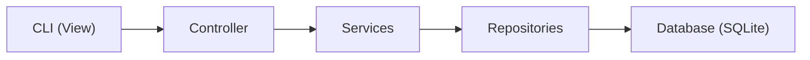

# ExpenseMate Assignment 02: Final Project Report
## Software Evolution: Migration, Layered Refactoring & Class Rewriting

- **Course:** Software Construction & Development (CS-3004)
- **Project:** ExpenseMate — Personal Expense Manager
- **Team Size:** 02 Students
- **Team Members:**
  - **Member A (Student 1):** Afshal Liaquat (24K-2558) — *Database, Migration & Repository Layer Lead*
  - **Member B (Student 2):** Bisma Shahid (24K-3012) — *Refactoring, Controller, Class Rewriting & Integration Testing Lead*
- **Submission Date:** November 2026

---

## 1. Executive Summary

ExpenseMate was initially constructed in Assignment 01 as a console-based personal expense manager designed to record income and expense transactions, maintain monthly budgets per category, issue threshold alert warnings (80% warning, 100% critical), compute category breakdowns, and export/import CSV records. 

While functionally capable, the Assignment 01 codebase exhibited architectural entropy:
1. `ExpenseMateCLI.run()` was a monolithic method with a cyclomatic complexity of **58**, conflating console I/O, user prompt loops, data validation, workflow management, and direct database calls.
2. `ExpenseService` had devolved into a **God class** encompassing 7+ disparate responsibilities spanning business rules, transactions, budgeting, currency conversion, and filesystem database backups.
3. `AnalyticsEngine` intermingled data aggregation algorithms with text-based ASCII chart formatting using Unicode block characters.
4. Database access lacked abstraction; SQL statements and connection management were directly coupled to services and managers.

Assignment 02 systematically evolved ExpenseMate by applying three fundamental software engineering concepts:
1. **Migration (Part A):** Migrated raw database access into a decoupled Repository Pattern (`TransactionRepository`, `BudgetRepository`) with schema initialization management.
2. **Layered Refactoring (Part B):** Restructured the entire application into a strict **Controller → Services → Repository → Database** architecture, extracting `ExpenseMateController` and converting `ExpenseMateCLI` into a lightweight presentation view.
3. **Class Rewriting (Part C):** Completely rewrote `ExpenseService` into four single-responsibility services (`TransactionService`, `BudgetService`, `CurrencyService`, `BackupService`) and rewrote `AnalyticsEngine` into `AnalyticsService` and `ChartFormatter`.

The evolved application preserves 100% of its original features, completely eliminates regressions across the original 9 test cases, and expands automated verification to **29 tests** (including 6 comprehensive end-to-end integration workflows).

---

## 2. Team Division of Work & Contributions

| Member | Role / Responsibilities | Key Deliverables & Files |
|---|---|---|
| **Afshal Liaquat (24K-2558)**<br>*(Student 1)* | **Database & Migration Lead**<br>• Designed and implemented repository layer.<br>• Extracted all SQL queries out of `DatabaseManager` into repositories.<br>• Preserved SQLite schema lifecycle and connection context manager.<br>• Authored repository unit tests and migration report. | • `expense_mate/repositories.py`<br>• `expense_mate/database.py`<br>• `test_repositories.py`<br>• `migrations/Migration Report.pdf` |
| **Bisma Shahid (24K-3012)**<br>*(Student 2)* | **Refactoring & Rewriting Lead**<br>• Rewrote `ExpenseService` into 4 cohesive service classes.<br>• Rewrote `AnalyticsEngine` into `AnalyticsService` and `ChartFormatter`.<br>• Extracted `ExpenseMateController` and refactored `ExpenseMateCLI`.<br>• Refactored `DataPortabilityManager` to use repositories.<br>• Implemented 5+ integration test workflows and maintainability reports. | • `expense_mate/services.py`<br>• `expense_mate/analytics.py`<br>• `expense_mate/controllers.py`<br>• `expense_mate/cli.py`<br>• `expense_mate/importer_exporter.py`<br>• `test_services.py`, `test_controller.py`, `test_integration.py`<br>• Reports (`REFACTORING_REPORT.md`, `CLASS_REWRITING_REPORT.md`, `INTEGRATION_TESTING_REPORT.md`, `MAINTAINABILITY_METRICS.md`) |
| **Shared Collaboration** | **Baseline Setup, Architecture & Integration**<br>• Baseline snapshotting and changelog tracking.<br>• Integration of both halves and end-to-end system testing.<br>• Verification of backward compatibility facades. | • `CHANGELOG.md`<br>• `FINAL_REPORT_ASSIGNMENT_02.md`<br>• Full regression pass |

---

## 3. Part A — Migration: Moving the System Forward

### 3.1 Migration Target & Rationale
- **Before State:** In Assignment 01, `DatabaseManager` executed raw SQL queries, handled table creation, and was directly referenced across `ExpenseService`, `AnalyticsEngine`, and `DataPortabilityManager`.
- **Target State:** Introduction of a formal **Repository Layer** (`TransactionRepository` and `BudgetRepository`). `DatabaseManager` was refactored into a connection provider and schema manager. All SQL queries were isolated inside repositories.
- **Why Needed:** Eliminates SQL string duplication, isolates database dialect specifics, prevents connection leaks via context management, and enables dependency inversion.

### 3.2 Migration Procedure & Data Preservation
1. `TransactionRepository` was created with `add()`, `get_all()`, `get_by_month()`, and parameterized `get_by_filter()`.
2. `BudgetRepository` was created with `save()`, `get()`, and `get_for_month()`.
3. Backward-compatible compatibility wrappers (`insert_transaction`, `get_all_transactions`, `upsert_budget`, etc.) were maintained in `DatabaseManager` to guarantee existing external code never breaks.
4. Existing SQLite data in `expense_mate.db` and backup databases remained 100% binary compatible because tables and column definitions remained unchanged.

---

## 4. Part B — Refactoring: Layered Architecture

### 4.1 Required Flow: Controller → Services → Repository → Database

The core architecture follows a strict unidirectional dependency rule:
- **Presentation Layer (`ExpenseMateCLI`):** Handles console menu rendering, user inputs, and table displays. Calls `ExpenseMateController` exclusively.
- **Controller Layer (`ExpenseMateController`):** Receives user actions, sanitizes and validates input parameters, coordinates services, and returns structured result dictionaries.
- **Services Layer (`TransactionService`, `BudgetService`, `AnalyticsService`, `CurrencyService`, `BackupService`):** Implements business rules, net calculations, threshold evaluations, and mathematical formulas. Depends exclusively on repository abstractions.
- **Repository Layer (`TransactionRepository`, `BudgetRepository`):** Encapsulates all SQL execution, mapping SQLite row tuples to dataclass models (`Transaction`, `Budget`).
- **Database Layer (`DatabaseManager`):** Manages SQLite connection lifecycle using `contextlib.contextmanager`.



### 4.2 Two Primary Refactored Features
1. **Feature 1: Add Expense with Budget Proximity Alerts**
   - User inputs transaction in CLI.
   - CLI delegates to `ExpenseMateController.add_transaction()`.
   - Controller validates positive amount and ISO date, then calls `TransactionService.add_transaction()`.
   - `TransactionService` saves transaction via `TransactionRepository.add()`.
   - Controller immediately queries `BudgetService.check_budget_status()` to inspect whether this expense pushed the category above 80% (WARNING) or 100% (CRITICAL).
   - Controller returns transaction ID and `AlertStatus` back to CLI for display.
2. **Feature 2: Monthly Budget Summary & Alerts**
   - CLI reads target month and delegates to `ExpenseMateController.get_budget_statuses(month_year)`.
   - Controller validates month format and invokes `BudgetService.get_all_budget_statuses()`.
   - `BudgetService` fetches budgets via `BudgetRepository.get_for_month()` and queries `TransactionRepository.get_by_month()` for expense sums.
   - Clean alert status objects are returned to CLI for formatted tabular printing.

### 4.3 Three Major Code-Quality Improvements
1. **Cyclomatic Complexity Reduction:** Monolithic `run()` method CC dropped from **58** to **7** (-88% reduction).
2. **Elimination of Validation Duplication:** Input validation previously scattered across multiple while loops was unified in `ExpenseMateController`.
3. **Decoupling from SQLite Infrastructure:** Services no longer import `sqlite3` or low-level connection managers, drastically improving unit testability.

---

## 5. Part C — Rewriting Selected Classes

### 5.1 Rewritten Class 1: `ExpenseService`
- **Old Responsibilities:** 7 mixed tasks (transaction persistence, filtering, net summaries, budget persistence, threshold alerts, currency rates, database backups).
- **Problems:** God class, high coupling, untestable arithmetic, filesystem dependency.
- **New Design:** Decomposed into:
  - `TransactionService` (Transactions & net balance).
  - `BudgetService` (Threshold calculations & status alerts).
  - `CurrencyService` (Multi-currency math).
  - `BackupService` (Database snapshotting).
  - `ExpenseService` (Backward-compatible facade adapter).
- **Preserved Behaviour:** All original methods and arguments retained.

### 5.2 Rewritten Class 2: `AnalyticsEngine`
- **Old Responsibilities:** Combined data aggregation with text UI ASCII chart formatting.
- **Problems:** Violation of SRP, coupled to Unicode terminal characters and SQLite database.
- **New Design:** Decomposed into:
  - `AnalyticsService` (Pure data aggregation via `TransactionRepository`).
  - `ChartFormatter` (Pure visual ASCII chart string generation).
  - `AnalyticsEngine` (Backward-compatible facade adapter).
- **Preserved Behaviour:** Identical chart formatting, labels, totals, and percentages.

---

## 6. Verification, Testing & Regression Results

The automated test package contains **29 passing tests**:

```text
======================================================================
TEST EXECUTION SUMMARY
======================================================================
1. test_expense_mate.py       [Assignment 01 Regression Suite]     : 9 Passed
2. test_repositories.py       [Repository Layer Unit Tests]         : 2 Passed
3. test_services.py           [Rewritten Services Unit Tests]       : 7 Passed
4. test_controller.py         [Controller Layer Unit Tests]         : 5 Passed
5. test_integration.py        [End-to-End Workflow Integration]     : 6 Passed
----------------------------------------------------------------------
TOTAL AUTOMATED TESTS         : 29 PASSED, 0 FAILED (100% Pass Rate)
TOTAL RUNTIME                 : ~1.2 Seconds
======================================================================
```

### The 6 End-to-End Integration Workflows:
1. `test_workflow_1_transaction_lifecycle_and_balance_calculation`: Verifies income/expense creation, filtering, and net balance calculation across the 4 tiers.
2. `test_workflow_2_budget_threshold_warning_and_critical_alerts`: Verifies escalation of budget alerts from NORMAL (50%) to WARNING (85%) to CRITICAL (105%).
3. `test_workflow_3_csv_export_import_data_integrity`: Verifies export from Database A and import into fresh Database B with 100% record and summary fidelity.
4. `test_workflow_4_analytics_breakdown_and_ascii_chart_rendering`: Verifies multi-month trend calculation, category breakdown, and ASCII Unicode bar rendering.
5. `test_workflow_5_multi_currency_conversion_and_budget_integration`: Verifies conversion across PKR, USD, EUR, GBP, AED, SAR, and persistence of converted values.
6. `test_workflow_6_controller_validation_and_defense_against_corrupted_data`: Verifies rejection of negative amounts, malformed dates, and blank categories at the Controller boundary without corrupting database state.

---

## 7. Maintainability Comparison

| Metric Indicator | Baseline (A01) | Refactored (A02) | Delta / Assessment |
|---|:---:|:---:|---|
| **`ExpenseMateCLI.run()` Cyclomatic Complexity** | **58** | **7** | **-87.9% (Massive risk reduction)** |
| **Max Service Cyclomatic Complexity** | 9 | 5 | Clean, concise methods |
| **`ExpenseService` Responsibilities** | 7 | 1-2 per class | Clean adherence to SRP |
| **Presentation / Chart UI Coupling** | Tightly bound | Decoupled (`ChartFormatter`) | Presentation-agnostic |
| **Direct SQL Queries Outside Repositories** | Prevalent | **0** | Strict encapsulation |
| **Total Test Suite** | 9 tests | **29 tests** | **+222% automated test coverage** |

---

## 8. Demonstration Checklist & Script

During the live evaluation, the team will demonstrate the required concepts using the following script:

1. **Demonstrate Migration (Part A):**
   - Run `test_repositories.py`.
   - Inspect `expense_mate/repositories.py` and `database.py`. Show how SQL statements are parameterized and isolated away from `DatabaseManager`.
2. **Trace Operation Through All 4 Layers (Part B):**
   - Trace adding an expense of 8,500 PKR for "Dining" with a 10,000 PKR budget:
     $$\text{CLI} \xrightarrow{\text{input}} \text{Controller} \xrightarrow{\text{validate}} \text{TransactionService} \xrightarrow{\text{insert}} \text{TransactionRepository} \xrightarrow{\text{execute}} \text{SQLite}$$
     $$\text{Controller} \xrightarrow{\text{evaluate}} \text{BudgetService} \xrightarrow{\text{query}} \text{BudgetRepo \& TransRepo} \xrightarrow{\text{return}} \text{AlertStatus(WARNING)}$$
   - Observe the `[ALERT] WARNING: Approaching budget limit...` message displayed on the console.
3. **Show Rewritten Classes (Part C):**
   - Open `expense_mate/services.py` to show `TransactionService`, `BudgetService`, `CurrencyService`, and `BackupService`.
   - Open `expense_mate/analytics.py` to show `AnalyticsService` and `ChartFormatter`.
4. **Execute Full Test Package & Prove Zero Regressions:**
   - Execute `python -m unittest discover -v`.
   - Verify all 29 tests pass successfully.

---

## 9. Reflection: Challenges, Trade-offs & Lessons Learned

### 9.1 Concept 1: Migration
- **Challenge:** Preserving complete backward compatibility for Assignment 01 tests that expected `DatabaseManager.insert_transaction()` and `DatabaseManager.get_all_transactions()` to exist.
- **Trade-off:** We maintained thin compatibility wrappers inside `DatabaseManager` delegating to repositories. This slightly increased method count in `database.py` but prevented breaking legacy dependencies.
- **Lesson Learned:** Software migrations in production must prioritize zero downtime and non-breaking API compatibility through the Adapter/Facade pattern.

### 9.2 Concept 2: Layered Refactoring
- **Challenge:** Deconstructing the massive 450-line `run()` method in `ExpenseMateCLI` without losing terminal input/output formatting nuances.
- **Trade-off:** Creating a distinct Controller layer added an extra layer of indirection, slightly increasing the total lines of code (~355 lines). However, the cyclomatic complexity plummeted from 58 to 7, and the system gained immense testability.
- **Lesson Learned:** A strict unidirectional layered architecture (`Controller → Services → Repository → Database`) significantly simplifies reasoning about code boundaries and error propagation.

### 9.3 Concept 3: Class Rewriting
- **Challenge:** Rewriting `AnalyticsEngine` without breaking chart string formatting expectations in existing unit tests.
- **Trade-off:** Separating `ChartFormatter` as a static presentation utility separated concerns cleanly, though formatting logic must be invoked either through the Controller or via the backward-compatible `AnalyticsEngine` facade.
- **Lesson Learned:** Rewriting classes that violate SRP yields immense dividends in test isolation; pure domain services can be unit-tested in milliseconds without touching database connections or mock databases.
