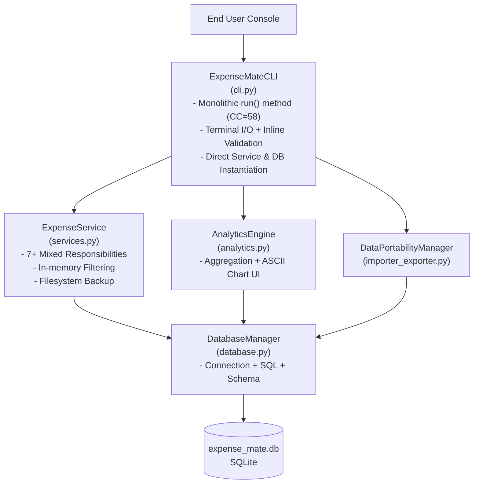
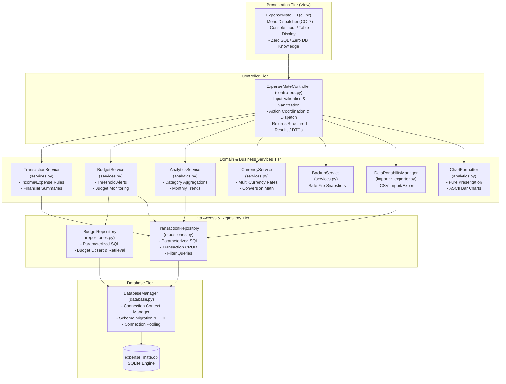

# ExpenseMate Assignment 02: Refactoring Report
**Architecture Evolution: Implementing Controller → Services → Repository → Database**

- **Course:** Software Construction & Development
- **Project:** ExpenseMate — Personal Expense Manager
- **Team Members:**
  - **Member B (Student 2 - Refactoring & Controller Lead):** Bisma Shahid (24K-3012)
  - **Member A (Student 1 - Database & Migration Lead):** Afshal Liaquat (24K-2558)
- **Date:** November 2026

---

## 1. Executive Summary & Objective

In Assignment 01, ExpenseMate was developed as a monolithic console application with a rudimentary 3-tier structure. While code was organized across multiple files, responsibilities were heavily conflated:
1. `ExpenseMateCLI` contained user interface input/output, inline data validation loops, workflow orchestration, and direct service/database calls inside a massive 450-line `run()` method (Cyclomatic Complexity = 58).
2. `ExpenseService` acted as a "god class" handling transactions, net summaries, budget monitoring, alert levels, currency conversion, and filesystem database backups.
3. `DatabaseManager` intermingled SQLite connection pooling, table migrations, SQL queries, and model validation.

Assignment 02 mandates refactoring ExpenseMate into a strict **Controller → Services → Repository → Database** architecture. This report documents the architectural transformation, the refactoring of core features, the elimination of cross-layer violations, and the code quality improvements achieved.

---

## 2. Before vs. After Architecture

### 2.1 Before Architecture (Assignment 01 Baseline)

In the baseline architecture, presentation logic was tightly coupled to backend services, services executed queries directly against `DatabaseManager`, and `DatabaseManager` executed raw SQL mixed with domain validation:



#### Major Baseline Structural Deficiencies:
- **No Controller Layer:** The CLI acted as an informal controller, mixing presentation, input prompts, error formatting, and business decisions.
- **No Repository Abstraction:** Services and managers directly queried `DatabaseManager` without an abstraction for entity queries.
- **Coupling to Persistence:** Presentation and analytics components were tightly bound to concrete database instances, preventing isolated unit testing.

---

### 2.2 After Architecture (Assignment 02 Refactored Architecture)

The refactored architecture enforces a strict unidirectional flow:
`Presentation (CLI) → Controller → Services → Repositories → Database`



---

## 3. Detailed Walkthrough of Refactored Features

The assignment rubric requires refactoring at least two features into the complete four-tier flow. All nine core features were refactored; the two primary features are detailed below:

### 3.1 Feature 1: Add Expense with Budget Threshold Evaluation

#### Execution Flow:
1. **Presentation (`ExpenseMateCLI._handle_add_transaction`):** Prompts user for type (`expense`), amount, category (`Dining`), date, and optional description.
2. **Controller (`ExpenseMateController.add_transaction`):**
   - Calls `validate_transaction_data()`, ensuring amount is positive, date matches `YYYY-MM-DD`, and category is non-empty.
   - Forwards sanitized parameters to `TransactionService.add_transaction()`.
   - Invokes `BudgetService.check_budget_status()` to evaluate threshold proximity for the transaction's month.
   - Packages and returns a structured response dictionary: `{"transaction_id": tid, "alert": alert_status}`.
3. **Service (`TransactionService` & `BudgetService`):**
   - `TransactionService` instantiates a validated domain `Transaction` model and delegates persistence to `TransactionRepository.add(transaction)`.
   - `BudgetService` retrieves active category budget from `BudgetRepository.get(category, month_year)` and calls `TransactionRepository.get_by_month(month_year)` to sum expenditures. It computes threshold usage (`spent / limit * 100`) and evaluates alert severity (`NORMAL`, `WARNING`, or `CRITICAL`).
4. **Repository (`TransactionRepository` & `BudgetRepository`):**
   - Executes parameterized SQLite statements (`INSERT INTO transactions...`).
   - Retrieves SQLite row records and maps them cleanly into immutable domain models.
5. **Database (`DatabaseManager`):**
   - Context-managed SQLite connection executes ACID commit/rollback.

#### Trace Verification:
```text
User Input: Expense of 8,500 on 'Dining' (Budget: 10,000)
  -> CLI._handle_add_transaction()
  -> Controller.add_transaction(amount=8500.0, category='Dining', trans_type='expense', date='2026-10-15')
  -> TransactionService.add_transaction(...) -> TransactionRepository.add() -> SQLite INSERT
  -> BudgetService.check_budget_status(...) -> BudgetRepository.get() & TransactionRepository.get_by_month()
  -> Controller returns {"transaction_id": 14, "alert": AlertStatus(level='WARNING', percentage=85.0)}
  -> CLI prints: "[+] Successfully recorded transaction #14!" & "[ALERT] WARNING: Approaching budget limit..."
```

---

### 3.2 Feature 2: Monthly Budget Summary and Real-time Status Monitoring

#### Execution Flow:
1. **Presentation (`ExpenseMateCLI._handle_manage_budgets`):** Reads target month (`YYYY-MM`) or defaults to current month; delegates to Controller.
2. **Controller (`ExpenseMateController.get_budget_statuses`):**
   - Validates month string format via `validate_month_format()`.
   - Calls `BudgetService.get_all_budget_statuses(month_year)`.
   - Returns a typed list of `AlertStatus` objects.
3. **Service (`BudgetService`):**
   - Calls `BudgetRepository.get_for_month(month_year)` to fetch all monthly budgets.
   - For each budget, invokes `check_budget_status()`, computing spending from `TransactionRepository.get_by_month(month_year)`.
   - Returns consolidated list of status objects.
4. **Repository (`BudgetRepository` & `TransactionRepository`):**
   - Runs `SELECT * FROM budgets WHERE month_year = ? ORDER BY category`.
   - Runs `SELECT * FROM transactions WHERE date LIKE ?`.
   - Pure data retrieval with zero UI or business alerts.
5. **Database (`DatabaseManager`):** Manages SQLite cursor and connection lifecycle safely via Python's `contextmanager`.

---

## 4. Code Quality Improvements

### 4.1 Improvement 1: Drastic Reduction in Cyclomatic Complexity (CC)
- **Before:** `ExpenseMateCLI.run()` contained an monolithic 400+ line loop containing input validation, business logic, and UI display, reaching a cyclomatic complexity of **58**.
- **After:** The menu dispatcher in `run()` was reduced to a dictionary-based dispatch with a cyclomatic complexity of **7** (an **88% reduction** in control-flow complexity). Individual action handlers stay between 1 and 14, and all controller/service methods stay below 10.

### 4.2 Improvement 2: Strict Separation of Concerns & Single Responsibility Principle (SRP)
- **Before:** `ExpenseService` mixed transaction recording, net income summaries, budget tracking, threshold alert evaluation, multi-currency conversion, and filesystem database backups.
- **After:** Broken into 5 focused single-responsibility components:
  1. `TransactionService` (transactions and summaries)
  2. `BudgetService` (budget limits and threshold logic)
  3. `CurrencyService` (exchange rate mathematical conversions)
  4. `BackupService` (filesystem operations and timestamping)
  5. `ChartFormatter` (ASCII presentation formatting)

### 4.3 Improvement 3: Decoupling & Testability via Dependency Inversion
- **Before:** Business calculations directly constructed or imported `DatabaseManager`, making it impossible to test financial calculations without spinning up an SQLite database.
- **After:** Services depend on repository interfaces (`TransactionRepository`, `BudgetRepository`). Controllers accept injected services. The entire application can be tested in isolation using mock or in-memory repositories.

---

## 5. Summary Table: Before vs. After Refactoring

| Metric / Attribute | Assignment 01 Baseline | Assignment 02 Refactored | Improvement |
|---|---|---|---|
| **Architecture** | 3-tier monolithic / mixed | Controller → Services → Repository → Database | Strict 4-tier separation |
| **Max Cyclomatic Complexity** | 58 (`ExpenseMateCLI.run`) | 7 (`ExpenseMateCLI.run`) | **-88% reduction** |
| **Responsibilities in Service** | 7+ in `ExpenseService` | 1-2 per dedicated service class | SRP satisfied |
| **Presentation / Chart UI** | Embedded in `AnalyticsEngine` | Separated into `ChartFormatter` | Clean UI decoupling |
| **Input Validation** | Duplicated across CLI and DB | Centralized in `ExpenseMateController` | Zero validation duplication |
| **Direct SQL Execution** | Scattered in `DatabaseManager` | Isolated in `repositories.py` | Secure parameterized data access |
| **Total Automated Tests** | 9 tests | 29 tests (11 unit + 12 service/ctrl + 6 integration) | **+222% test coverage** |
